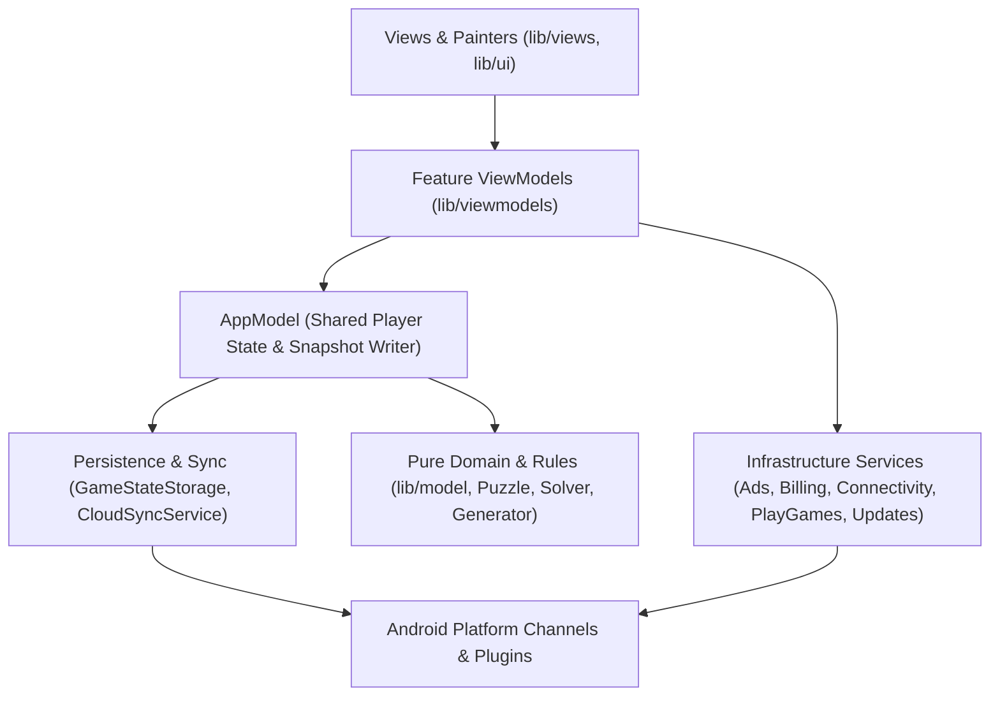
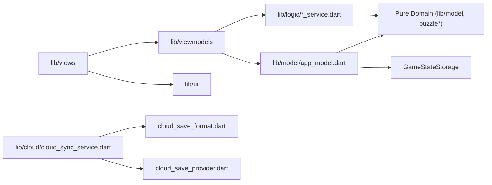
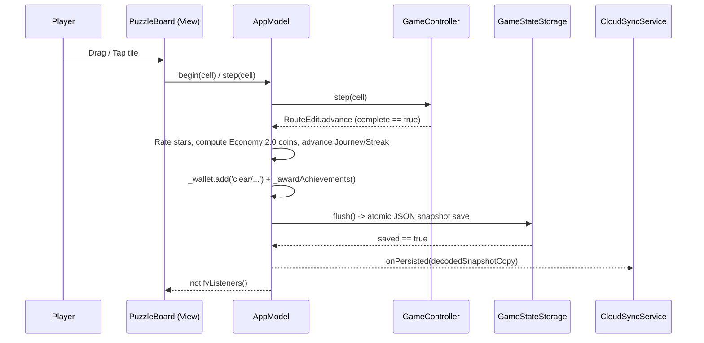
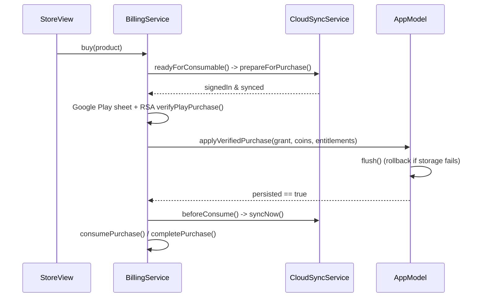
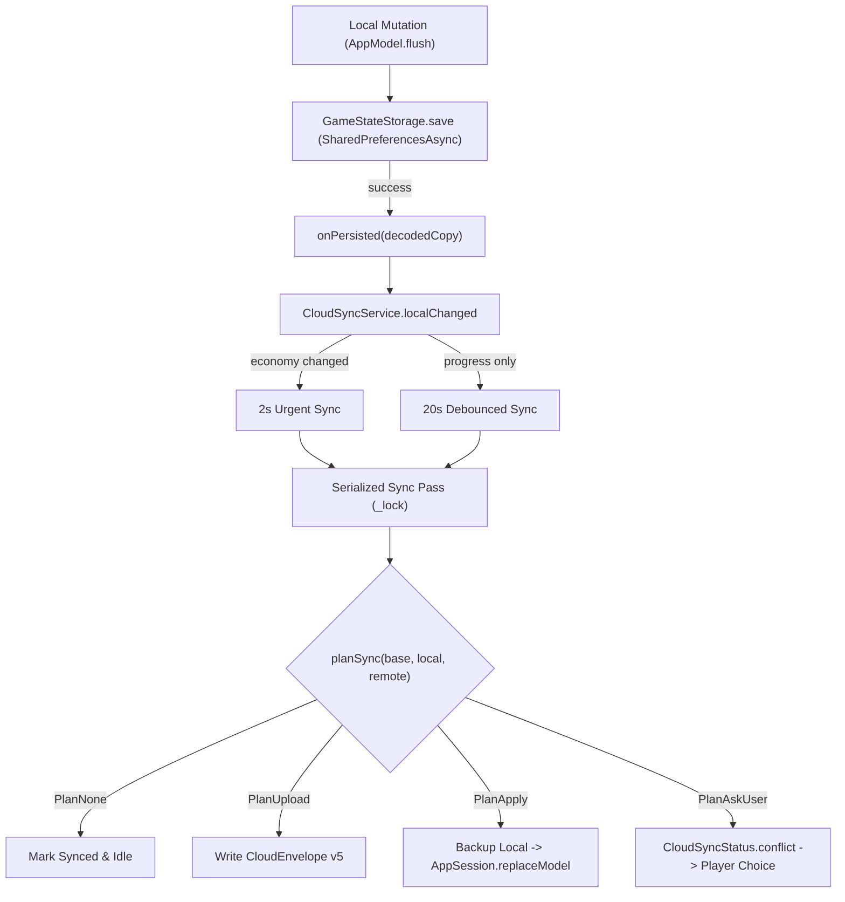
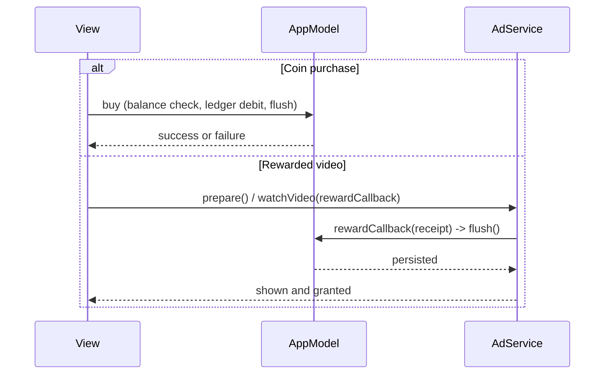

# Pathwise Architecture

Pathwise is a local-first, offline-capable Android route-drawing puzzle built with Flutter and `Provider`. This document describes the target MVVM architecture, dependency boundaries, state ownership, transaction integrity, persistence/cloud sync, and practical development rules.

---

## 1. Overall Architecture

Pathwise is organized into five strict layers:

1. **Views (`lib/views/`, `lib/ui/`)**: Declarative Flutter widgets, `CustomPainter`s, gesture collection, animations, accessibility, and palette application. Views delegate user intentions to ViewModels and observe state via `Provider` (`context.select`, `ValueListenableBuilder`, scoped tickers).
2. **ViewModels (`lib/viewmodels/`)**: Widget-free, `BuildContext`-free coordinators for the screens that need orchestration beyond `AppModel` calls: `HomeViewModel` (opening and leaving puzzles), `StreakViewModel` (freeze purchases), `CrateViewModel` (crate claims) and `StatisticsViewModel` (statistics and achievement summaries). Other screens call `AppModel` and the infrastructure services directly. Add a ViewModel when a view starts to accumulate service orchestration; do not add one that no view uses.
3. **Application State & Persistence Coordinator (`lib/model/app_model.dart`)**: Single coherent source of truth for shared player state (`Wallet`, `Progression`, `PlayStreak`, `UserPreferences`, `AchievementLedger`, results, unlocks, cosmetics, entitlements) and atomic snapshot persistence (`flush()`).
4. **Domain & Pure Logic (`lib/model/`, `lib/logic/puzzle*.dart`, `lib/logic/game_controller.dart`, `lib/logic/star_rating.dart`, `lib/logic/mechanic_tutorials.dart`, `lib/logic/ad_frequency.dart`, `lib/cloud/cloud_save_format.dart`)**: Pure Dart rules for puzzle generation/solving, route validation, Economy 2.0 payouts, star ratings, and cloud sync planning.
5. **Repositories & Infrastructure Services (`lib/logic/game_state_storage.dart`, `lib/cloud/`, `lib/logic/ad_service.dart`, `lib/logic/billing_service.dart`, `lib/logic/connectivity_service.dart`, `lib/logic/achievement_sync.dart`, `lib/logic/attack_clock.dart`, `lib/logic/play_games.dart`, `lib/logic/update_service.dart`)**: Local storage, Play Games Saved Games, AdMob, Google Play Billing, connectivity probing, native elapsed clock, and Play In-App Updates.

---

## 2. Dependency Direction

- **Inward-only dependencies**: Views depend on ViewModels, `AppModel`, and UI helpers; ViewModels depend on `AppModel` and service interfaces; `AppModel` depends on domain models and storage/connectivity abstractions; pure domain models and `cloud_save_format.dart` have **zero** Flutter UI or platform dependencies.
- **No upward dependencies**: `lib/logic/` never imports `lib/views/`, `lib/ui/`, or `AppModel` (e.g., `AchievementSync` depends on `AchievementSyncTarget`, not `AppModel`). `lib/cloud/` never imports `lib/logic/` or `lib/model/`.
- **Automated enforcement**: `test/architecture/architecture_boundaries_test.dart` verifies import boundaries on every CI run.

---

## 3. State Ownership & Initialization

- **Application Initialization (`lib/main.dart`)**:
  - `main()` configures `PaintingBinding.instance.imageCache` (48 MiB / 200 entries), registers licenses, constructs `GameStateStorage`, `AttackClock`, `ConnectivityService`, `PreferencesKeyValueStore`, and `AppSession` (owning `CloudSyncService` and `AppModel`).
  - On Android, native launch screen stays visible while `initialize()` syncs `AttackClock` and loads `pathwise.save.v1` (schema 16).
  - `PathwiseRoot` provides `AppModel`, `ConnectivityService`, and `CloudSyncService`, and `PathwiseApp` provides `BillingService`, `AdService`, and `AchievementSync`.
- **Single Source of Truth**:
  - `AppModel` owns the authoritative in-memory `Wallet`, `Progression`, `PlayStreak`, hints, cosmetics, entitlements, and puzzle results. ViewModels never duplicate mutable balances or entitlements.
  - `AppSession.replaceModel(payload)` flushes the restored snapshot first and only swaps the active `AppModel` if `flush()` succeeds, disposing the previous `AppModel` post-frame.

---

## 4. Gameplay Completion & Reward Flow

`Puzzle` defines grid topology and movement rules; `GameController` owns route edits, undo history, and hint highlights; `puzzle_solver.dart` certifies uniqueness in an isolate (`compute`). `PuzzleBoard` separates rendering into `board-layer`, `pointer-layer` (`_TipPainter` driven by `TipTracker` without `rejection` repaints), and `rejection-layer`.

---

## 5. Purchase & Transaction Flow

All coin debits, ad rewards, and Google Play purchases use stable, idempotent ledger IDs (`purchase/<sha256>`, `ad/<id>`, `crate-ad/<receipt>`, `journey/multiplier/<level>`, `tip/<name>`, `theme/<name>`). Async ad/purchase mutations roll back in-memory state if `flush()` fails, and `applyVerifiedPurchase` rejects mutations when `storageError` is active.

---

## 6. Local Persistence & Cloud Synchronization

The device save (`pathwise.save.v1`, schema 16) is authoritative for offline gameplay. `CloudSyncService` runs serialized passes (`_lock`), compares `economyDigest` and `payloadDigest` against `CloudBase`, merges only `progressKeys` automatically, and prompts the player via `CloudChoiceWatcher` when both devices modified economy.

---

## 7. View Interaction

Views forward user intentions to `AppModel`, a ViewModel or an infrastructure service and render the typed result, without embedding economy formulas. Rewarded videos follow one shape everywhere: the view asks `AdService` to show a video with a reward callback, the callback applies one ledger-ID transaction through `AppModel` and persists it, and the view reports the outcome. High-frequency timers (Fortune Wheel cooldown, active boost countdowns, the star bar) live in leaf widgets so a tick never rebuilds a screen.

---

## 8. Navigation, Lifecycle & Performance Boundaries

- **Lifecycle**: `PathwiseRoot` observes `AppLifecycleState` to pause/resume `ConnectivityService` and trigger `cloud.syncNow()` on backgrounding. `PathwiseApp` manages `AttackClock` sync, `AchievementSync.foreground`, and midnight `dayCheck`.
- **Android-only**: Dormant iOS/StoreKit code is prohibited (`test/architecture/architecture_boundaries_test.dart` enforces this).
- **Performance**:
  - `PuzzleBoard` isolates pointer motion in `_TipPainter` and rejection flashes in `_RejectionPainter`.
  - `GameAssetCache` bounds image memory and guards Journey evictions with a generation counter so late in-flight decodes cannot leak back into cache.
  - Journey node sprites use `cacheWidth` to cap decoded bitmap memory.

---

## 9. Practical Rules for Future Development

1. **Never put business rules or economy math in `lib/views/`**. Put them in `AppModel` or the pure domain, and keep any ViewModel `BuildContext`-free.
2. **Never add Flutter UI or `AppModel` imports to `lib/model/` (except `app_model.dart`/`app_themes.dart`), `lib/cloud/`, or `lib/logic/`**. Run `flutter test test/architecture` to verify.
3. **Preserve `AppModel` as the single source of truth** for balances, inventory, cosmetics, and entitlements. Never copy mutable balances into ViewModels.
4. **Keep async transactions atomic**: any new `AppModel` reward or purchase persisted via `flush()` must guard against `storageError` and roll back in-memory mutations if `flush()` fails.
5. **Scope timers and `context.select` to leaf widgets** so countdowns and pointer updates never rebuild entire screens.
6. **Guard every `await` in `State` classes** with `if (!mounted) return;` and reset `_busy` flags in `try/finally`.
